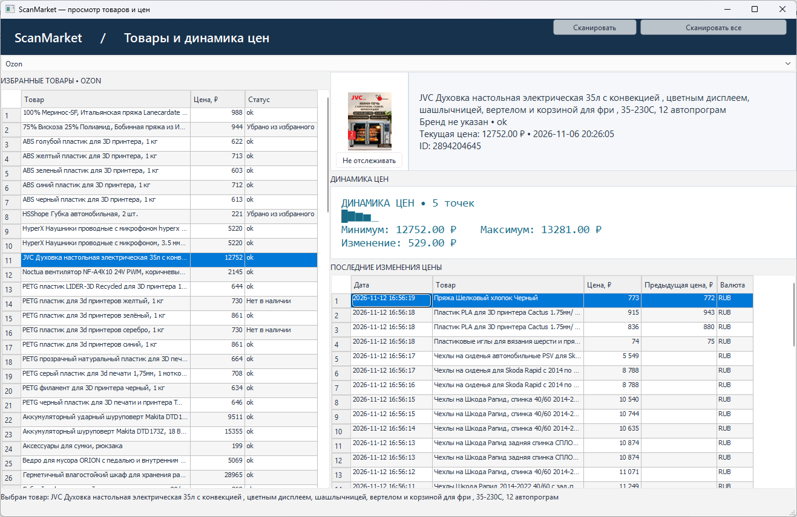

# ScanMarket

[English](README.en.md) · [Русский](README.md)

> **Статус проекта: активная подготовка.** Репозиторий большой и ещё
> дорабатывается: часть исходных текстов и документации публикуется поэтапно,
> возможны изменения структуры и команд. Проверяйте актуальность инструкций
> перед использованием.

ScanMarket периодически читает товары из избранного Ozon, Wildberries и Яндекс
Маркета и сохраняет в SQLite сведения о товарах и историю изменения цен.
Просмотр товаров, истории цен и графиков выполняется в локальном GUI.

Проект написан на языке сценариев Qode (Script) и поставляется вместе с
Qode Runtime, поэтому готов к запуску сразу после клонирования — отдельная
установка чего-либо не требуется.

## Содержание

- [Возможности](#возможности)
- [Требования к системе](#требования-к-системе)
- [Qode Runtime](#qode-runtime)
- [Структура проекта](#структура-проекта)
- [Установка и первый запуск](#установка-и-первый-запуск)
- [Настройка config.json](#настройка-configjson)
- [Авторизация и cookies](#авторизация-и-cookies)
- [Запуск сканирования](#запуск-сканирования)
- [Планировщик Windows](#планировщик-windows)
- [GUI](#gui)
- [База данных и история цен](#база-данных-и-история-цен)
- [Диагностика](#диагностика)
- [Лицензия](#лицензия)

## Возможности

- Сбор карточек избранного с Ozon, Wildberries и Яндекс Маркета через
  управляемый браузер и Chrome DevTools Protocol (CDP).
- Сохранение товаров, миниатюр и истории изменения цен в SQLite.
- Новая точка цены создаётся только при изменении цены — история не засоряется.
- Фильтрация рекламных и рекомендательных карточек, учёт антибот-проверок.
- Авторизация с сохранением cookies и профиля браузера в `private_data/`.
- Настройка автоматического запуска через планировщик Windows (schtasks).
- Локальный GUI: таблицы товаров и истории цен, карточка товара, график
  динамики цен, переключатель магазинов.

## Требования к системе

- Windows 10/11 (x64).
- Поддерживаемый Chromium-браузер: Yandex Browser, Microsoft Edge или Google
  Chrome (для авторизации и сканирования).
- Авторизованные учётные записи:
  - Ozon — [Избранное](https://www.ozon.ru/my/favorites);
  - Wildberries — [Избранное](https://www.wildberries.ru/lk/favorites);
  - Яндекс — [Вишлист](https://market.yandex.ru/my/wishlist).
- Свободное место для базы данных и профиля браузера (сотни МБ и более).
- Права на создание задач планировщика (для автозапуска).

## Qode Runtime

ScanMarket написан на собственном языке сценариев Qode (Script), по
возможностям сопоставимом с Python. Для выполнения скриптов нужна среда
выполнения Qode Runtime, которая поставляется в каталоге `bin/`:

- `qode.exe` — консольный движок без Qt (для диагностических утилит);
- `qodeqt.exe` — консольный движок с Qt-адаптером и модулем `db` (для
  сканирования и авторизации);
- `qodegui.exe` — движок с GUI (запуск формы `scanmarket_gui.json`);
- `qodedesigner.exe` — редактор JSON-форм;
- `plugins/` — плагины Qode (http, websocket и др.);
- `platforms/`, `imageformats/`, `sqldrivers/`, `styles/`, `tls/`,
  `iconengines/`, `generic/`, `networkinformation/`, `translations/` —
  плагины Qt, DLL Qt 6.11.2.

Ядро Qode — собственный компонент проекта; скомпилированная среда выполнения
входит в поставку, а исходный код публикуется по мере готовности. Лицензии:
скрипты, библиотеки и Qode Runtime — MIT (`LICENSE`), сторонние компоненты
описаны в [THIRD_PARTY_NOTICES.md](THIRD_PARTY_NOTICES.md).

## Структура проекта

```text
.
├── ozon_auth.prg              # вход в Ozon и сохранение cookies
├── ozon_check_session.prg     # проверка авторизованного избранного
├── ozon_scan.prg              # сканирование и запись истории цен
├── ozon_setup_cron.prg        # создание задачи планировщика Windows
├── wildberries_auth.prg       # вход в Wildberries и сохранение cookies
├── wildberries_check_session.prg # проверка избранного Wildberries
├── wildberries_scan.prg       # сканирование Wildberries
├── wildberries_setup_cron.prg # задача планировщика для Wildberries
├── yandexmarket_auth.prg      # вход в Яндекс Маркет и сохранение cookies
├── yandexmarket_check_session.prg # проверка вишлиста Яндекс Маркета
├── yandexmarket_scan.prg      # сканирование Яндекс Маркета
├── yandexmarket_setup_cron.prg # задача планировщика для Яндекс Маркета
├── scanmarket.bat             # запуск GUI
├── scan_ozon.bat              # запуск сканирования Ozon (для планировщика)
├── scan_wildberries.bat       # запуск сканирования Wildberries
├── scan_yandexmarket.bat      # запуск сканирования Яндекс Маркета
├── scan_all.prg               # последовательное сканирование всех магазинов
├── auth_ozon.bat              # запуск авторизации Ozon
├── auth_wildberries.bat       # запуск авторизации Wildberries
├── auth_yandexmarket.bat      # запуск авторизации Яндекс Маркета
├── config.json                # настройки браузера, магазинов, базы и расписания
├── config.example.json        # образец конфигурации (без персональных данных)
├── scanmarket_gui.json        # описание GUI-формы
├── bin/                       # Qode Runtime, Qt DLL и плагины
├── lib/                       # библиотеки проекта (Script)
│   ├── config.prg             # загрузка конфигурации
│   ├── cdp.prg                # браузер и Chrome DevTools Protocol
│   ├── dbstore.prg            # схема SQLite и операции с данными
│   ├── ozon.prg               # разбор страницы Ozon
│   ├── wildberries.prg        # разбор страницы Wildberries
│   ├── yandexmarket.prg       # разбор страницы Яндекс Маркета
│   └── scanutil.prg           # функции диагностической утилиты
├── scriptlib/                 # общие библиотеки Script/Qode (автоматизация)
├── tools/                     # утилиты
│   ├── scanutils.prg          # диагностика и обслуживание
│   ├── export_gui_data.prg    # экспорт данных Ozon в JSON
│   ├── update_gui_stores.prg  # восстановление переключателя магазинов в GUI
│   ├── gui_store_block.prg    # блок Script для update_gui_stores.prg
│   ├── add_gui_scan_buttons.prg # кнопки запуска сканирования в GUI
│   └── gui_scan_block.prg     # блок Script для add_gui_scan_buttons.prg
├── test/                      # проверочные скрипты
├── docs/                      # документация языка Script/Qode
├── LICENSES/                  # тексты лицензий сторонних компонентов
├── THIRD_PARTY_NOTICES.md     # перечень сторонних компонентов и лицензий
└── private_data/              # ПРИВАТНЫЕ данные: базы, cookies, профиль
```

Каталог `private_data/` создаётся при первом запуске и исключён из Git. В него
складываются базы SQLite, cookies, профиль браузера и диагностические снимки.

## Установка и первый запуск

1. Клонируйте репозиторий или скопируйте каталог проекта в любое место
   (путь без пробелов предпочтителен, но не обязателен).

   ```bat
   git clone git@github.com:alexartrider/scanmarket.git
   cd scanmarket
   ```

2. Проверьте, что Qode Runtime на месте:

   ```bat
   bin\qode.exe tools\scanutils.prg caps
   ```

   Команда выводит возможности движка; код возврата `0` означает успех.
   Вывод утилит Qode пишется в `bin\log\` — при необходимости смотрите логи.

3. При первом запуске скрипты создадут `config.json` со значениями по
   умолчанию, либо скопируйте `config.example.json` в `config.json` и
   отредактируйте под себя.

4. Авторизуйте магазины (см. ниже) и выполните первое сканирование.

## Настройка config.json

Файл `config.json` создаётся автоматически при первом запуске с параметрами
по умолчанию. Образец со всеми настройками — `config.example.json`.

Основные параметры:

| Параметр | Назначение |
| --- | --- |
| `browser.headless` | Запуск без окна браузера (`0`/`1`). |
| `browser.execPath` | Путь к `browser.exe`/`msedge.exe`/`chrome.exe`; пустое значение — автоопределение. |
| `browser.debugPort` | Локальный порт Chrome DevTools Protocol, по умолчанию `9222`. |
| `browser.profileDir` | Каталог профиля браузера, по умолчанию `private_data/browser_profile`. |
| `browser.proxy` | Прокси: пусто — системные настройки, `direct` — без прокси, иначе адрес. |
| `ozon.favoritesUrl` | URL страницы избранного Ozon. |
| `ozon.waitLoginSeconds` | Максимальное ожидание входа/готовности страницы. |
| `ozon.pageWaitSeconds` | Ожидание загрузки страницы. |
| `ozon.maxScrollSteps` | Максимальное число шагов прокрутки списка. |
| `ozon.stopTrailing` | Порог последовательных карточек без признака избранного. |
| `ozon.chunk` | Число карточек в одном запросе к DOM. |
| `wildberries.*` | Аналогичные параметры для Wildberries (включая `dbPath`). |
| `yandexmarket.*` | Аналогичные параметры для Яндекс Маркета (включая `dbPath`). |
| `db.path` | Путь к базе Ozon, по умолчанию `private_data/ozon/ozon.sqlite`. |
| `cron.taskName` | Имя задачи планировщика для Ozon. |
| `cron.mode` | `daily` или `hourly`. |
| `cron.start` | Время запуска для `daily`, формат `HH:MM`. |
| `cron.everyHours` | Интервал в часах для `hourly`. |
| `cron.exe` | Исполняемый файл задачи, обычно `bin/qodeqt.exe`. |
| `cron.script` | Запускаемый скрипт, обычно `ozon_scan.prg`. |
| `cron.bat` | BAT-файл запуска задачи. |
| `cronWb.*`, `cronYm.*` | Те же параметры для Wildberries и Яндекс Маркета. |

Скрипты дополняют отсутствующие параметры значениями по умолчанию.

## Авторизация и cookies

Каждый магазин авторизуется отдельно. Cookies и профиль браузера хранятся в
`private_data/` и не попадают в репозиторий.

### Ozon

```bat
bin\qodeqt.exe ozon_auth.prg
```

Откроется окно браузера. Войдите в Ozon и дождитесь отображения списка
избранного. Скрипт сохранит cookies в `private_data/ozon/ozon_cookies.json`
и штатно закроет браузер.

### Wildberries

```bat
bin\qodeqt.exe wildberries_auth.prg
```

Войдите на Wildberries и дождитесь избранного. Cookies сохранятся в
`private_data/wildberries/wildberries_cookies.json` только если страница
избранного действительно загрузилась (карточек больше нуля).

### Яндекс Маркет

```bat
bin\qodeqt.exe yandexmarket_auth.prg
```

Войдите на Яндекс. Cookies сохранятся в
`private_data/yandexmarket/yandexmarket_cookies.json` только если вишлист
действительно загрузился.

Проверка действующей сессии:

```bat
bin\qodeqt.exe ozon_check_session.prg
bin\qodeqt.exe wildberries_check_session.prg
bin\qodeqt.exe yandexmarket_check_session.prg
```

## Запуск сканирования

```bat
bin\qodeqt.exe ozon_scan.prg
bin\qodeqt.exe wildberries_scan.prg
bin\qodeqt.exe yandexmarket_scan.prg
```

Скрипты открывают браузер с сохранённым профилем, читают карточки избранного,
обновляют базу в `private_data/<магазин>/`, сохраняют снимок результата в
`<магазин>_last_scan.json` и закрывают браузер. Если магазин запросил повторный
вход — выполните авторизацию заново.

> Не запускайте несколько сканирований одновременно с одним профилем браузера
> и одной базой.

## Планировщик Windows

Для автоматического запуска выполните (для каждого магазина):

```bat
bin\qodeqt.exe ozon_setup_cron.prg
bin\qodeqt.exe wildberries_setup_cron.prg
bin\qodeqt.exe yandexmarket_setup_cron.prg
```

Скрипты создают BAT-файл запуска и задачу планировщика Windows (schtasks).
Параметры задачи берутся из разделов `cron`, `cronWb`, `cronYm` файла
`config.json`. Запустить задачу вручную:

```bat
schtasks /run /tn "ScanMarketOzon"
```

## GUI

```bat
scanmarket.bat
```

GUI открывает `scanmarket_gui.json` через `bin\qodegui.exe`. В окне доступны
таблицы товаров и истории цен, карточка выбранного товара с миниатюрой,
график динамики цен и переключатель магазинов (Ozon / Wildberries /
Яндекс Маркет). В верхней строке формы (рядом с выбором магазина) находятся
кнопки запуска сканирования:



- **Сканировать** — запускает сканирование выбранного магазина
  (`bin\qodeqt.exe <магазин>_scan.prg`);
- **Сканировать все** — последовательно сканирует все магазины через
  `scan_all.prg`.

Во время сканирования кнопки блокируются, а по завершении таблицы товаров и
истории цен автоматически обновляются. Ход сканирования виден в отдельном
консольном окне.

Если GUI был обновлён вручную и нужно вернуть переключатель магазинов или
кнопки сканирования, выполните:

```bat
bin\qodeqt.exe tools\update_gui_stores.prg
bin\qodeqt.exe tools\add_gui_scan_buttons.prg
```

## База данных и история цен

Базы SQLite находятся в `private_data/`:

- `private_data/ozon/ozon.sqlite`;
- `private_data/wildberries/wildberries.sqlite`;
- `private_data/yandexmarket/yandexmarket.sqlite`.

Основные таблицы:

- `products` — товары: источник (`source`), идентификатор, название, бренд,
  ссылка, статус, миниатюра, состояние избранного и отслеживания;
- `price_points` — история цен: цена, старая цена, валюта, наличие, время;
- `scan_runs` — журнал запусков: число найденных товаров, новых точек, статус.

Новая точка в `price_points` создаётся только при изменении цены. Первое
наблюдение товара создаёт первую точку. Времена записываются по локальным
часам компьютера.

Экспорт товаров Ozon и истории цен в JSON:

```bat
bin\qodeqt.exe tools\export_gui_data.prg
```

Файл `private_data/scanmarket_view.json` содержит названия, ссылки, статусы и
историю цен.

## Диагностика

### Утилита `scanutils`

```bat
bin\qode.exe tools\scanutils.prg db
bin\qode.exe tools\scanutils.prg db private_data\wildberries\wildberries.sqlite
bin\qode.exe tools\scanutils.prg runs 20
bin\qode.exe tools\scanutils.prg points 20
bin\qode.exe tools\scanutils.prg tail 60
bin\qode.exe tools\scanutils.prg grep "auth_required"
bin\qode.exe tools\scanutils.prg cookies private_data\ozon\ozon_cookies.json
bin\qode.exe tools\scanutils.prg dump private_data\ozon\fav_challenge_dump.html
bin\qode.exe tools\scanutils.prg caps
```

Команды `db`, `runs`, `points` и `fixstale` принимают необязательным последним
аргументом путь к базе (по умолчанию — база Ozon). Также доступны `fixstale`,
`procs`, `readmeinfo`, `cleanroot` и `movefile`.

### Тесты загрузки модулей

```bat
bin\qodeqt.exe test\check_yandexmarket.prg
bin\qodeqt.exe test\run_tests.prg
```

### Логи

Журналы движка пишутся в `bin\log\` (кодировка может быть CP1251). Старые
журналы могут оставаться в `log/`.

### Частые проблемы

| Проблема | Решение |
| --- | --- |
| Магазин запросил повторный вход | Выполните авторизацию (`*_auth.prg`) заново. |
| Антибот-проверка при сканировании | Завершите проверку в открытом окне браузера; скрипт продолжит сам. |
| Товары не распознаются | Проверьте авторизацию, изучите `<магазин>_last_scan.json` и логи. Нулевой результат — не успех. |
| Код возврата утилиты отличен от 0 | Ошибка в скрипте; смотрите логи в `bin\log\`. |

## Лицензия

Проект ScanMarket (скрипты, библиотеки, Qode Runtime, документация)
распространяется по лицензии MIT — см. [LICENSE](LICENSE).

Сторонние компоненты (Qt 6.11.2, OpenSSL 3.5.4, libc++/libunwind, Mesa
llvmpipe и др.) распространяются под собственными лицензиями. Полный перечень
— в [THIRD_PARTY_NOTICES.md](THIRD_PARTY_NOTICES.md), тексты лицензий — в
[LICENSES/](LICENSES/).
